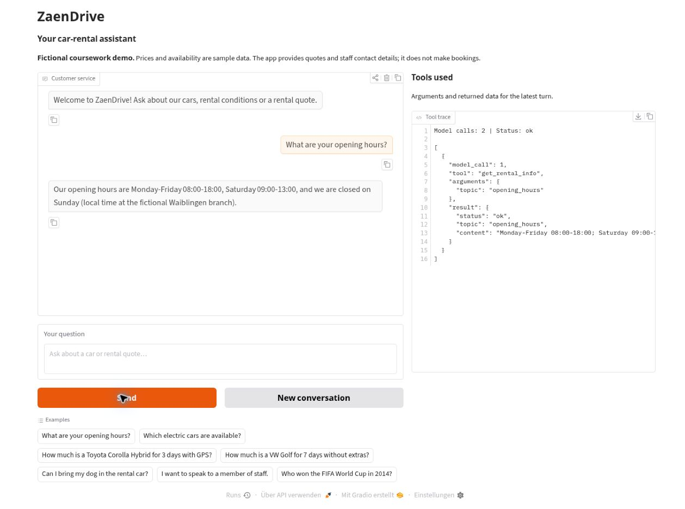
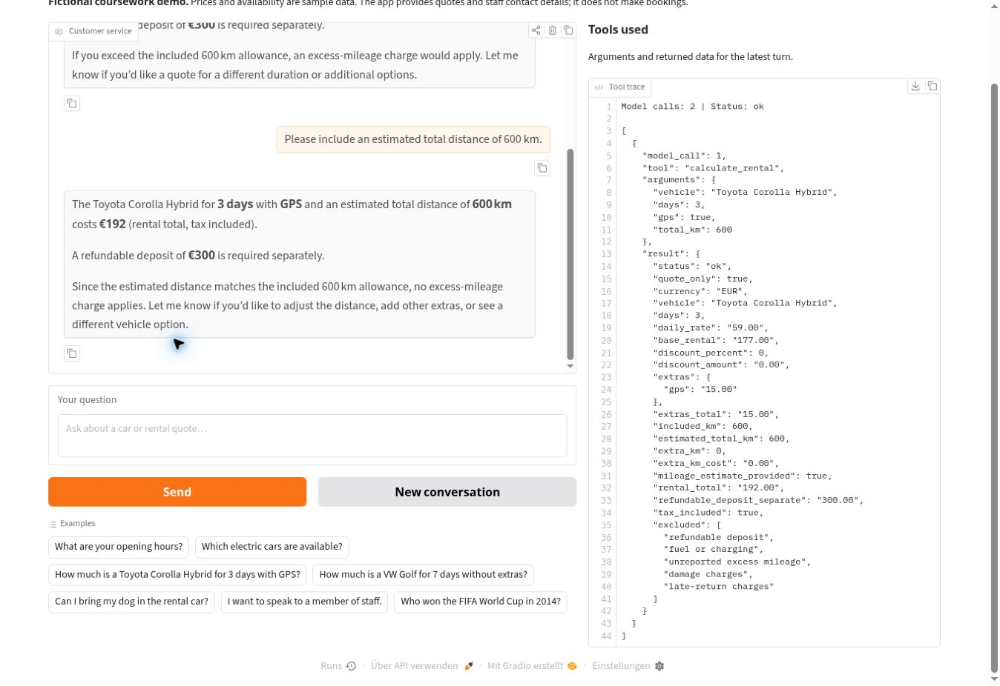
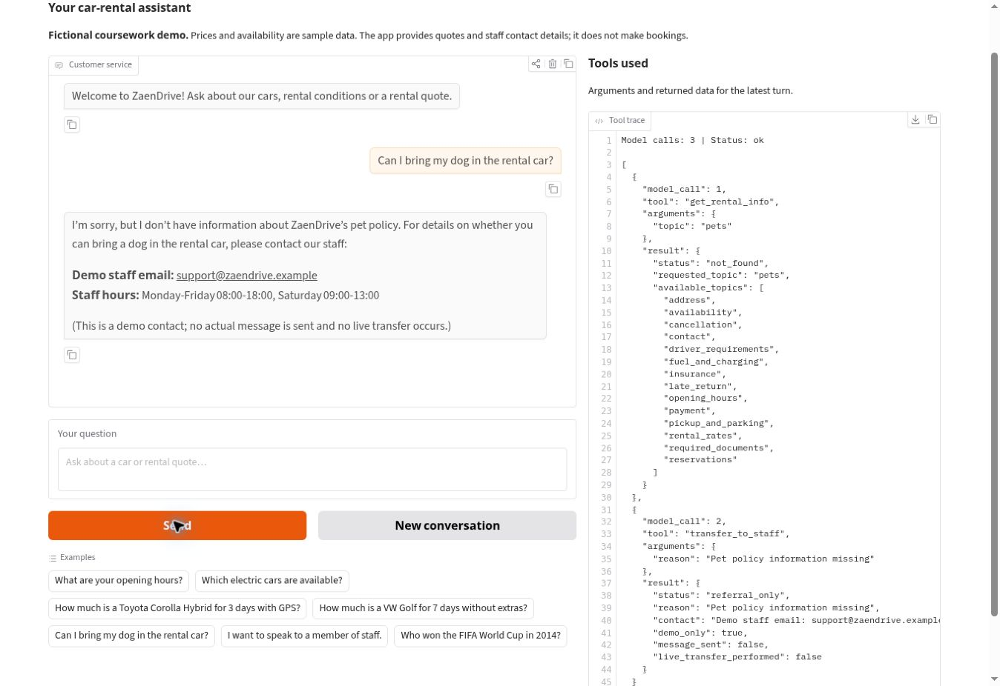
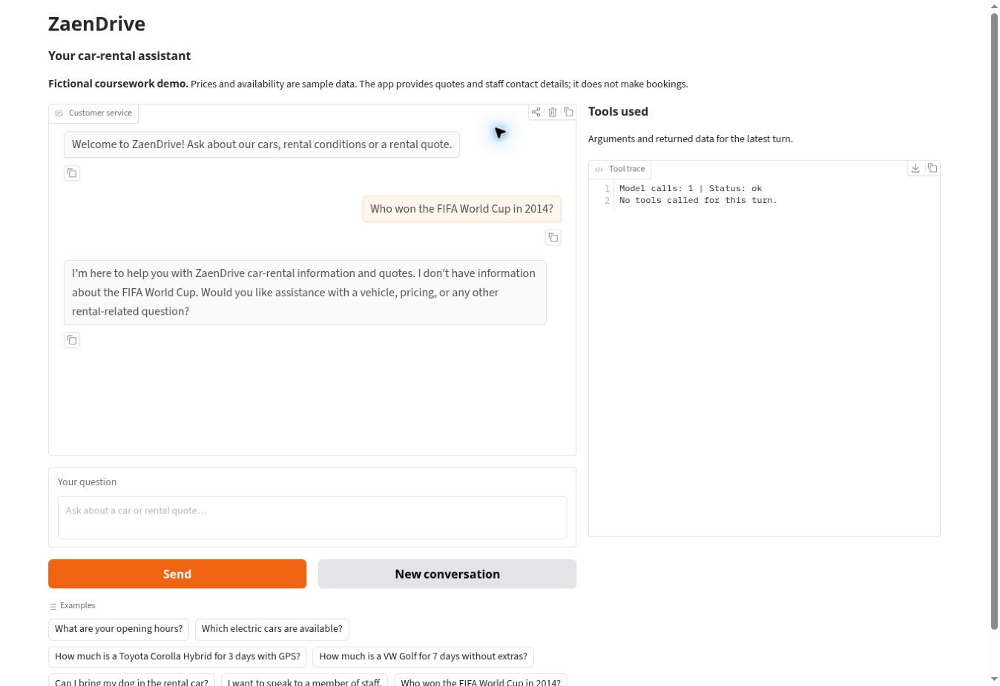
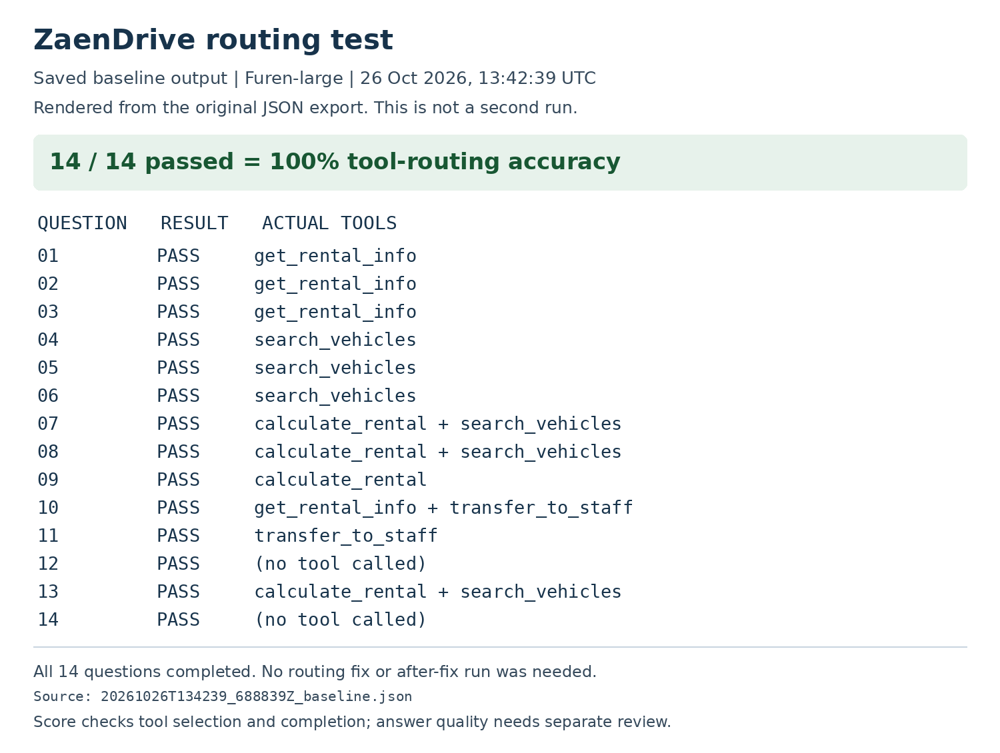

# ZaenDrive: A Tool-Based Car-Rental Assistant

ZaenDrive is a fictional car-rental customer-service agent. It answers questions about
the rental desk, searches a 16-vehicle demo fleet and calculates rental quotes from
SQLite data. Every business fact must come from a tool; the model chooses the tool
and writes a short customer-facing answer.

> Course homework: Unit G, My AI Customer Service Agent, with a Database and Tools
> Student: C115451101 — Zaen Alaabden Abdul Rahim
> Verified with Furen-large on 26 October 2026: **14/14 routing questions passed (100%)**.
> Four real Gradio conversation screenshots and the original baseline results are included.

## Who It Serves and When They Use It

- **Who uses it:** prospective rental customers and existing customers with policy questions.
- **When they use it:** while comparing vehicles, planning costs, or asking questions outside office hours.
- **What problem it solves:** repeated questions about vehicle prices, availability and rental conditions.

## What It Can Do

| Function | Example question | Tool it uses |
|---|---|---|
| Read rental policies | What are your opening hours? | `get_rental_info` |
| Search the demo fleet | Which electric cars are available? | `search_vehicles` |
| Calculate a rental quote | Corolla for 3 days with GPS? | `calculate_rental` |
| Provide staff contact details | I want to complain. | `transfer_to_staff` |

The staff tool is a **contact referral**, not a messaging integration. No email,
ticket or live transfer is sent. All contact information is fictional.

## How It Works

Every message goes to the model first. The model chooses one of the four registered
tools, receives structured data, and then answers. Tools use parameterized queries;
they never execute SQL or code supplied by the model. Unknown tools are refused.
The loop stops after `MAX_STEPS` model requests (default 6), and SDK retries are disabled.
The chat remembers prior messages and tool results in session state, while the
visible trace shows the tool calls for the most recent turn.

- **Tested model:** `Furen-large` at the NKUST endpoint. Settings are configurable;
  running the project requires your own authorized API key.
- **Chat screen:** Gradio Blocks, Python 3.10 or newer.
- **Database:** SQLite, rebuilt from both CSV files whenever the app starts.

| Table | CSV file | What it holds | Rows |
|---|---|---|---:|
| `rental_info` | `rental_info.csv` | Topics and policy content, including machine-readable rate rules | 14 |
| `vehicles` | `vehicles.csv` | Vehicle names, daily rates, seats, fuel, transmission, availability, aliases | 16 |

`rental_info` has columns `topic, content`. The `rental_rates` row stores a JSON object
inside `content`, so the calculator reads its policy numbers from the same database
as the information tool. `vehicles.csv` has `vehicle_id, name, category,
daily_rate_eur, seats, transmission, fuel_type, available, aliases`.
The database additionally derives a normalized `search_text` column for matching.

| Tool | What it does |
|---|---|
| `get_rental_info(topic)` | Looks up a topic; explicitly returns `not_found` for missing policies |
| `search_vehicles(keyword, available_only)` | Finds records using short names, categories or fuel types |
| `calculate_rental(vehicle, days, gps, child_seat, additional_driver, total_km)` | Calculates a quote with decimal arithmetic |
| `transfer_to_staff(reason)` | Returns the demo staff contact and states no message was sent |

Calculation: daily rate × days, minus a 10% base-rental discount for at least 7 days,
plus selected per-day extras and any specified excess mileage. The daily allowance
is 200 km and excess mileage costs EUR 0.25/km. The refundable EUR 300 deposit is
shown separately. The quote excludes fuel/charging and unreported excess mileage.
One GPS unit, one child seat and one additional driver can be selected.

Missing or ambiguous vehicle names, unavailable cars, non-integer durations,
durations outside 1–30 days and invalid distances return structured results;
the model must clarify or explain the limitation.

## Sample Conversations

These screenshots were captured from the running Gradio app using Furen-large on
26 October 2026. Each view includes the response and the tool trace.

### Opening hours from the database



### Rental quote and a follow-up

The customer first asks for a Toyota Corolla Hybrid for three days with GPS, then
adds an estimated distance of 600 km. The agent retains the earlier details and
calls `calculate_rental` again: EUR 177 base rental + EUR 15 GPS = **EUR 192**.
The refundable EUR 300 deposit is separate; 600 km is within the included allowance.



### Missing information

The pet-policy lookup returns `not_found`. The agent uses `transfer_to_staff`
and explains that the address is a demo contact and no real transfer occurs.



### Off-topic refusal



## Project Files

| File | Purpose |
|---|---|
| `app.py` | Gradio chat screen, greeting, example questions and visible trace |
| `agent.py` | System prompt, API client and bounded agent loop |
| `rental_tools.py` | CSV-to-SQLite setup, four tools and their schemas |
| `rental_info.csv`, `vehicles.csv` | All business data and pricing policies |
| `requirements.txt` | Dependency versions used for local verification |
| `.env.example`, `.gitignore` | Example configuration and excluded local files |
| `tool_choice_test.py` | 14 real model routing questions and evidence export |
| `test_offline.py` | 14 local code tests with scripted loop responses, no API calls |
| `C115451101_Zaen_CustomerService_Colab.ipynb` | Optional Colab launcher; not required for submission |
| `START_HERE_DE.md` | German setup steps |
| `images/` | Four real conversation screenshots and a rendering of the saved test results |
| `evidence/` | Original baseline JSON/CSV and a readable HTML view |
| `VALIDATION.md` | What was checked and what the score does not establish |

## How to Install and Run It

1. Download this repository as a ZIP from GitHub and extract it, or use the provided
   project ZIP. Open a terminal in the folder containing `app.py`.
   The repository's **Code** button also supplies the correct clone URL.

2. Use Python 3.10 or newer. Optionally create a virtual environment:

   ```bash
   python -m venv .venv
   ```

   Activate on Windows with `.venv\Scripts\activate`, or on macOS/Linux with
   `source .venv/bin/activate`.

3. Install the packages:

   ```bash
   python -m pip install -r requirements.txt
   ```

4. Copy `.env.example` to `.env` and enter your key in **your local file only**:

   ```bash
   copy .env.example .env
   ```

   On macOS/Linux use `cp .env.example .env`. Verify `LLM_API_URL` and `MODEL_NAME`
   against the credentials provided in class. The model must support tool calling.
   Never paste the key into an AI chat or upload `.env` to GitHub.

5. Run the offline checks, then launch:

   ```bash
   python -m unittest -v test_offline
   python app.py
   ```

6. Open the local URL printed by Gradio. For Colab, follow the included notebook.
   Its launch cell creates a temporary Gradio share link and reads the key through
   a Colab secret or a hidden input. It does not save the key into the notebook.

## Testing and Evidence

The first completed live run used **Furen-large** on **26 October 2026 at
13:42:39 UTC**. All **14/14 questions passed (100%)**. No routing fix was needed
and no after-fix score is claimed. The user ran the supplied code and model
configuration without changes. All five source hashes recorded in the baseline
JSON match the submitted files.

The [original JSON](evidence/20261026T134239_688839Z_baseline.json) includes full
answers, arguments and returned data. The [CSV summary](evidence/20261026T134239_688839Z_baseline.csv)
is also included. The image below is rendered from that saved export; it is not
a screenshot of a second test run.



Run the live tool-choice test **after verifying one chat question**:

```bash
python tool_choice_test.py --label baseline
```

The script prints all 14 questions, the acceptable tools, actual tools, answers and
the score. It saves timestamped JSON and CSV files in `test_results/`. Each question
starts a fresh conversation. The score checks exact sets of called tool names,
agent completion and the absence of malformed/unknown tool calls; it does not grade
answer truthfulness or all argument values. Inspect those separately using the trace.
An API error stops the run and produces no final score.

After a real change to the prompt or tool descriptions, rerun with
`--label after-fix`; preserve the first score and explain the change honestly.
If the first run passes, state that no routing fix was needed rather than inventing one.

Also capture four real conversations: a database question, a calculation,
missing information and an off-topic refusal. Test a follow-up such as “And for
7 days?” to confirm memory. Start a new conversation between independent screenshots.

`MIN_CALL_INTERVAL=5` adds spacing between model requests. Increase it if the
provider returns 429. Authentication, endpoint and tool-support errors are shown
without exposing the API key. The app does not train a model or require a GPU.

## Notes

- All business details, rental prices, vehicle configurations, availability and
  contact details are **fictional coursework data**, not real offers or manufacturer specifications.
- No live inventory, date-specific availability, reservations, payments or email delivery is integrated.
- Alias matching is implemented; it handles entries such as “Corolla”, “VW Golf” and “ID3”.
  It is not a general spelling-correction system.
- The prompt asks for replies in the customer's language. Language quality needs
  live testing; this project does not claim the optional program-controlled bilingual feature.
- Never publish `.env`, database files, API keys or notebook outputs containing credentials.
- The PDF report uses the teacher's original Word template. Submit it separately
  through the course site under the required filename.
- API/UI references: [Gradio Blocks](https://www.gradio.app/docs/gradio/blocks),
  [Gradio Chatbot](https://www.gradio.app/docs/gradio/chatbot),
  [OpenAI Python SDK](https://github.com/openai/openai-python).
